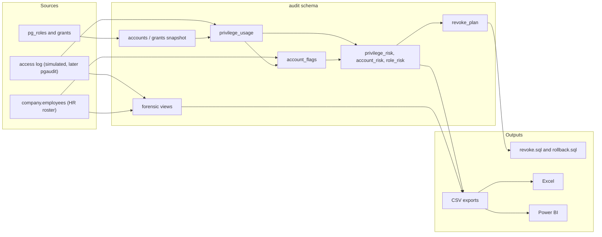

# Architecture

## Overview

Everything runs inside one PostgreSQL lab database (`privilege_audit`). The pipeline is a chain of numbered SQL scripts that move data through layers in the `audit` schema. Excel and Power BI sit on top as consumers of exported results.



## Layers and scripts

| Layer | Script | Produces |
|---|---|---|
| Lab source | `01` | `company.*` tables, roles, planted gaps |
| Snapshot | `02` | `audit.accounts`, `audit.granted_privileges` |
| Evidence | `03` | `audit.analysis_config`, `audit.usage_log` |
| Detection | `04` | `audit.table_sensitivity`, `audit.privilege_usage`, `audit.account_flags` |
| Scoring | `05` | `audit.privilege_weights`, `privilege_risk`, `account_risk`, `role_risk` |
| Remediation | `06` | `audit.revoke_plan` |
| Proof | `07` | comparison queries; needs the `after` and `restored` snapshots |
| Forensics | `08` | views `audit.forensic_events`, `forensic_ip_usage`, `forensic_accounts`; case file CSV |
| Integrity | `09` | `audit.log_seal`, `audit.log_anchor`; views `log_row_digest`, `log_current_head`, `log_verification` |

## Data contracts

`05` consumes these tables. `02` and `04` produce them in this shape (`05` reads only the columns it needs).

| Table | Built by | Columns |
|---|---|---|
| `audit.analysis_config` | 03 | `as_of`, `window_days` (180), `stale_days` (90). Single row |
| `audit.usage_log` | 03 | `event_time`, `account`, `client_ip`, `table_name`, `action` |
| `audit.accounts` | 02 | `snapshot`, `account`, `can_login`, `is_superuser`, `can_createrole`, `member_of text[]`, `collected_at` |
| `audit.granted_privileges` | 02 | `snapshot`, `account`, `table_name`, `privilege`, `granted_via` (one row per source: `direct` or `role:<name>`) |
| `audit.privilege_usage` | 04 | `snapshot`, `account`, `table_name`, `privilege`, `granted_via text[]`, `uses`, `last_used`, `days_since_use`, `status` (`active` / `stale` / `never_used`) |
| `audit.table_sensitivity` | 04 | `table_name`, `sensitivity` (1 to 5), `sensitive_columns` |
| `audit.account_flags` | 04 | `snapshot`, `account`, `flag`, `evidence` |
| `audit.revoke_plan` | 06 | `plan_id`, `snapshot`, `category`, `decision` (`AUTO` / `REVIEW`), `target`, `table_name`, `privilege`, `reason`, `risk_points`, `revoke_sql`, `rollback_sql` |
| `audit.log_seal` | 09 | `log_id`, `seq`, `content_hash`, `chain_hash` |
| `audit.log_anchor` | 09 | `sealed_at`, `log_rows`, `head_hash` |

`granted_via` holds `role:<rolename>` entries and/or `direct`. `05` relies on that format to attribute risk to roles.

Flags `05` already understands: `LEAVER_ACTIVE` and `SUPERUSER` force the `CRITICAL` tier. Any other flag gives at least `HIGH`. Flags raised by `04`: `LEAVER_ACTIVE`, `SUPERUSER`, `CREATEROLE`, `DORMANT`, `SHARED_ACCOUNT`, `ROLE_MISMATCH` (the mover check).

## Risk model

```
risk_points = sensitivity x privilege_weight x days_unused
```

- Weights: SELECT 1, INSERT 3, UPDATE 3, DELETE 5
- `days_unused`: 0 if active, days since last use if stale, full window (180) if never used
- Account tier: `CRITICAL` on a critical flag, `HIGH` on any flag or percentile 75 and up, `MEDIUM` at 50 and up, otherwise `LOW`
- Role risk is attributed through `granted_via`, so a role shows how much of the total risk it creates
- Tiers are percentile-based, so they are relative to the other accounts. Compare risk points, not tier counts, to measure change between snapshots

Active privileges score zero by design. The model measures *unjustified* access, not access in general. Critical attributes like `SUPERUSER` are caught by flags instead.

## Remediation rules (06)

| Situation | Action | Decision |
|---|---|---|
| Direct grant not in active use | REVOKE from the account | AUTO |
| Role privilege that no member uses | REVOKE from the role | AUTO |
| Role privilege that only some members use | Listed without SQL, because a role grant cannot be revoked per member | REVIEW |
| Leaver with a working login | NOLOGIN and removal from roles | AUTO |
| Mover in a role of the old department | Remove from the role if no active privilege depends on it | AUTO, otherwise REVIEW |
| SUPERUSER / CREATEROLE, dormant account, shared account | Statement or note supplied | REVIEW |

Every action stores its own rollback statement. Proof (07): replaying the log against the `after` grants denied none of the 1,321 recent events by current staff, and the rollback file restores grants and accounts identical to `before`.

## Design decisions

- **Snapshots**: every table is keyed by a snapshot name (`before`, `after`), so the same code scores both states and the comparison is honest.
- **Leaver activity is not legitimate use**: events after a termination date are excluded when judging whether a privilege is in use.
- **Known limit**: the log records table access only, so use of `SUPERUSER` / `CREATEROLE` is invisible and those accounts are flagged by their attributes instead.
- **Parameters**: `as_of` and `snapshot` are psql variables. Using `CURRENT_DATE` against a real log needs no code change.
- **Idempotent scripts**: each script clears its own snapshot rows and rebuilds, so re-runs are safe.
- **Lab guard**: roles are cluster-wide, so `01` aborts unless connected to `privilege_audit`.
- **Human in the loop**: remediation produces scripts to review. It never executes them.
- **Rollback first**: no REVOKE is generated without its matching GRANT.

## Forensics and log integrity (08, 09)

- `08` builds views over the usage log joined with the HR roster. Each event is labelled `normal`, `after termination` or `no HR owner`. A case file for one account (profile, activity by month, what it did, latest events) is printed and written to `exports/case_<account>.csv`.
- `09` seals the log with a hash chain: a `content_hash` per row (all fields, including `log_id`), then `chain_hash(n) = sha256(chain_hash(n-1) || content_hash(n))`. The last value, the head hash, changes if any row is edited, deleted or added. `audit.log_verification` labels each row `OK`, `MODIFIED`, `DELETED` or `INSERTED`.
- Trust model: sealing trusts the log as it is at that moment. The head hash must be copied outside the database, because someone who rewrites the log, the seal and the anchor together can only be caught by that outside copy.
- Tamper test: one reassigned event, one deleted event and one planted event were each pinpointed and the head hash changed. The test runs in a transaction that is rolled back.
- Reloading the log with `03` drops these views (`CASCADE`), so `08` and `09` are run again afterwards.

## Tooling

- PostgreSQL and psql: all logic
- Git Bash on Windows: running scripts, version control
- Excel: pivots and quick analysis on CSV exports
- Power BI: dashboard on the same exports
- GitHub Actions (planned): rebuild and check on every push
